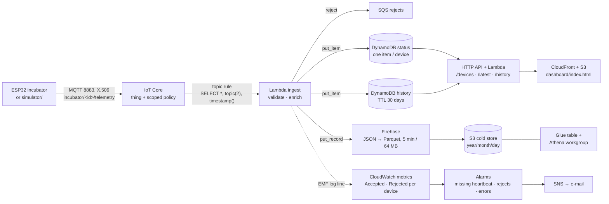
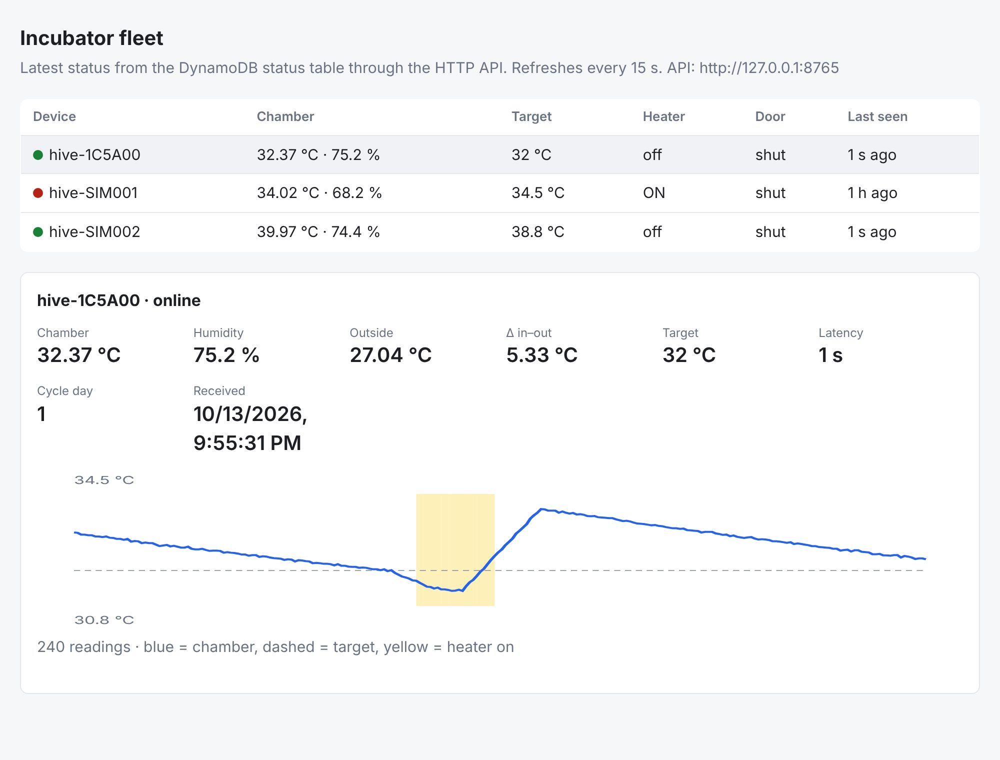

# aws-iot-telemetry-pipeline

This repo shows a complete device-to-cloud telemetry pipeline for the queen-bee incubator as
infrastructure as code (AWS CDK, Python): MQTT with per-device X.509 certificates into IoT
Core, a rule into a validating Lambda, a hot store in DynamoDB with a 30-day TTL, a cold
store of Parquet files in S3 queried with Athena, heartbeat alarms, and a small status API
with a static dashboard. It uses the exact record format the incubator firmware already
sends, so it is a drop-in cloud side for the existing device.

**Nothing here has been deployed.** The build sandbox has no AWS account and the project
rules forbid deploying from it. What is verified: `cdk synth` produces a valid template,
49 tests pass (Lambda handlers against `moto`, the simulator, stack assertions), and the
simulator runs in dry-run mode. The deploy steps below are written for a laptop with
credentials.

## Architecture



One stack, six constructs (`src/pipeline/`): `devices` (things, policy, certificate
placeholders), `storage` (hot + cold), `ingest` (rule, Lambda, reject queue), `api`,
`dashboard`, `monitoring`. Tunables live in `cdk.json` → `context` (device ids, TTL,
heartbeat period, alarm e-mail, certificate ARNs, retain-data switch).

## Run it

```sh
python -m venv .venv && . .venv/bin/activate
pip install -r requirements-dev.txt
npm install -g aws-cdk@2            # the CDK CLI (Node 18+)
make check                          # ruff + 49 pytest + cdk synth + simulator dry run
make cost                           # the cost tables below
make screenshot                     # docs/dashboard.png via the mock API (needs playwright)
python simulator/simulate.py --dry-run --count 5           # model-generated records
python simulator/simulate.py --dry-run --replay simulator/sample_history.json --count 5
```

To deploy from your own machine (never from CI):

```sh
cdk bootstrap                        # once per account/region
cdk deploy -c alarm_email=you@example.com
scripts/provision_device.sh hive-SIM001 eu-central-1      # creates cert + key, prints the ARN
# put the ARN into cdk.json -> certificate_arns, then: cdk deploy
curl -o simulator/certs/AmazonRootCA1.pem https://www.amazontrust.com/repository/AmazonRootCA1.pem
python simulator/simulate.py --endpoint <iot-ats-endpoint> --device-id hive-SIM001 \
  --cert simulator/certs/hive-SIM001.pem.crt --key simulator/certs/hive-SIM001.private.key
```

Then open the `DashboardUrl` output. `make plan` runs `cdk diff`. `cdk destroy` removes
everything, including data, unless `retain_data` is true.

## What it looks like



Rendered by `scripts/screenshot_dashboard.py` from `dashboard/index.html` served by
`scripts/mock_api.py`, a local stand-in for the HTTP API fed by the simulator model (so the
numbers are simulated, not from a deployment). The red dot is a device whose last message is
older than two heartbeat periods; the yellow band is heater-on; the dip is a door opening.
`python scripts/mock_api.py` then <http://127.0.0.1:8765/> gives you the same page locally.

## What goes where

| Field set | Where | Why |
|---|---|---|
| `ts, temp, hum, targetTemp, heater` (+ `tempOut, humOut, door, cycleDay, cycleCode, elapsedSec, iso`) | sent by the device, validated in `lambdas/common/telemetry.py` | the firmware's existing record; unknown fields are dropped, ranges checked, clock skew bounded |
| `device_id, received_at, latency_s, delta_in_out, expires_at, day, schema_version` | added by the ingest Lambda | the device id comes from the MQTT topic (which the policy pins to the certificate), never from the payload |
| latest record per device | DynamoDB `status` table | one `get_item` for the dashboard, scan for the fleet list |
| every record, 30 days | DynamoDB `history` table, key `device_id` + `ts`, TTL on `expires_at` | windowed queries for charts; TTL deletes are free |
| every record, forever | S3 Parquet, `telemetry/year=/month=/day_of_month=/` | Athena at $5/TB scanned; partition projection so no crawler is needed (`athena/queries.sql`) |
| rejected messages | SQS queue, 14 days | a bad firmware build becomes visible instead of vanishing |

## Monthly cost estimate (from `scripts/cost.py`)

Unit prices are US East (N. Virginia) list prices typed from the pricing pages linked in
the script. **They could not be re-checked from the build sandbox** (aws.amazon.com was
unreachable), so re-read the pages before quoting these numbers. Free tiers are ignored.

One message every 15 s per device (the incubator's real rate):

| Service | 10 devices | 1 000 devices |
|---|---:|---:|
| IoT Core connectivity | $0.03 | $3.46 |
| IoT Core messaging | $1.73 | $172.80 |
| IoT rules + actions | $0.52 | $51.84 |
| Lambda ingest | $1.05 | $105.34 |
| DynamoDB writes (history + status) | $2.16 | $216.00 |
| DynamoDB storage (30-day TTL) | $0.19 | $19.44 |
| Firehose ingest + Parquet conversion | $0.42 | $41.58 |
| S3 cold storage (first month) | $0.00 | $0.24 |
| Athena | $0.05 | $0.05 |
| CloudWatch metrics (2 per device + 2 fleet) | $6.60 | $600.60 |
| CloudWatch alarms (1 per device + 3) | $1.30 | $100.30 |
| CloudWatch logs (EMF lines) | $0.35 | $34.56 |
| API Gateway + status Lambda (3 dashboard viewers) | $1.24 | $1.24 |
| CloudFront + SQS + Glue catalog | $0.00 | $0.00 |
| **Total per month** | **$15.65** | **$1,347.45** |

At one message a minute the totals drop to about $10.83 and $866. Two things the table
teaches: (1) at 1 000 devices more than half the bill is **per-device CloudWatch metrics
and alarms**, so the heartbeat design in this repo (one alarm per thing, fine for a fleet
of ten) must change to a scheduled Lambda that scans the status table for stale `received_at`
values and raises one fleet metric (see TODO.md); (2) the 5 KB minimum per Firehose record
makes a 350-byte message cost 14× its size, so batching records before `put_record` would
cut that line by ~90 %.

## Security notes

- **One certificate per thing, one policy for all.** The IoT policy uses
  `${iot:Connection.Thing.ThingName}` so a device may only connect with its own thing name
  (and only if the certificate is attached to that thing), publish only to
  `incubator/<its-name>/telemetry`, and subscribe only to its own `commands` topic. A stolen
  certificate cannot impersonate another hive or read the fleet.
- The device id in every stored record comes from the topic, not from the JSON, so a
  device cannot write under another id.
- Lambdas get table-level grants only (write for ingest, read for the API), `PutRecord` on
  the one stream, `SendMessage` on the one queue. Metrics go out as EMF log lines, so no
  CloudWatch permission at all.
- Both buckets block public access and require TLS; the dashboard bucket is read only
  through CloudFront origin access control. The API is GET-only, throttled to 10 req/s,
  and unauthenticated: it exposes fleet temperatures to anyone with the URL. Add a
  Cognito or IAM authoriser before putting real hives on it.
- Certificates and keys are created by `scripts/provision_device.sh` on a laptop; the
  stack only receives ARNs. `.gitignore` refuses `*.pem`, `*.key`, `*.crt`.

## From Firebase RTDB to this design

The incubator in production writes to Firebase Realtime Database straight from the ESP32
and the Flutter app listens to it. The same ideas map onto this pipeline:

| Firebase RTDB concept | Here | What changes |
|---|---|---|
| `hives/<id>/status` node, overwritten each reading | `status` DynamoDB table, one item per device | same shape; `get_item` instead of a listener |
| `hives/<id>/history` node, appended forever | `history` table (30 days, TTL) + S3 Parquet (forever) | the app no longer downloads the whole node; history is queried by time window, long-term analysis moves to SQL |
| database secret or open rules on the device | X.509 certificate per thing + scoped IoT policy | no account-wide secret on the device; revoking one certificate affects one hive |
| security rules JSON | IAM grants + IoT policy variables | checked at connect/publish time by IoT Core, not per path on read |
| Cloud Functions on write | IoT topic rule → Lambda | validation happens *before* anything is stored |
| console JSON export for analysis | Athena over Parquet | `SELECT` instead of loading a 50 MB JSON into pandas |
| realtime listener in the app | dashboard polls the HTTP API every 15 s | the trade-off of this repo; a push path would be IoT Core over WebSocket or AppSync |

## Limitations

- Not deployed: IAM and policy behaviour is asserted from the template, not exercised.
  `cdk synth` passes; `cdk deploy` has not been run.
- The simulator's thermal model (fitted parameters from `incubator-telemetry-analysis`)
  with a plain hysteresis switch overshoots by about 2 °C; it is there to produce plausible
  traffic, not to study control (that is `incubator-thermal-control-sim`).
- `simulator/sample_history.json` is one real hour (240 readings, 3 Oct 2026) from the
  incubator export, with timestamps shifted to "now" on replay.
- Heartbeat alarms are per device and only for the ids listed in `cdk.json`.
- Firehose partitions by arrival time, not device time; a device backfilling a week of
  buffered data lands in today's partition (the `day` column still holds the device date).
- Cost figures are hand-typed list prices, unverified in the sandbox.

## Next steps

See TODO.md: a scalable heartbeat check, record batching into Firehose, an authoriser on
the API, a `commands` path back to the device, and the first real deploy.

## Licence

MIT, see LICENSE.
